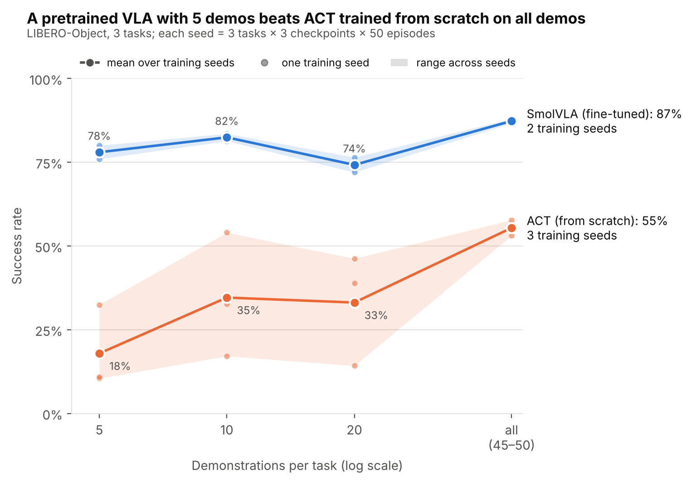
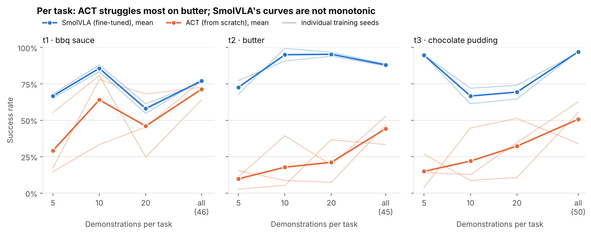
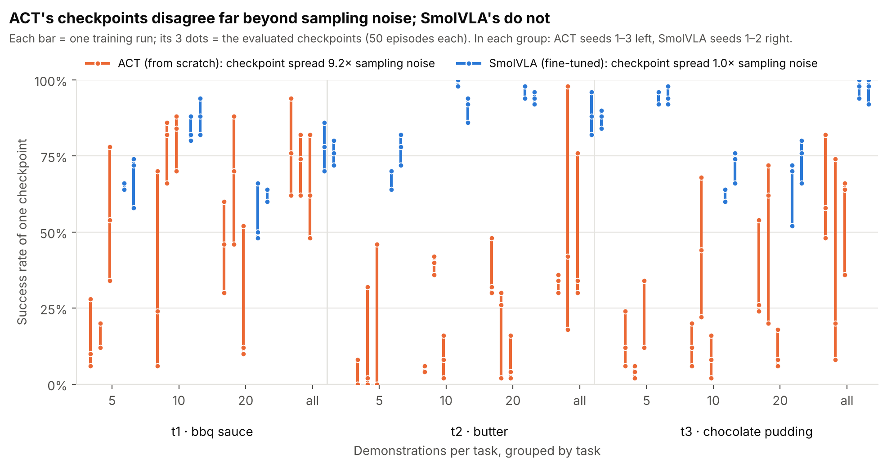
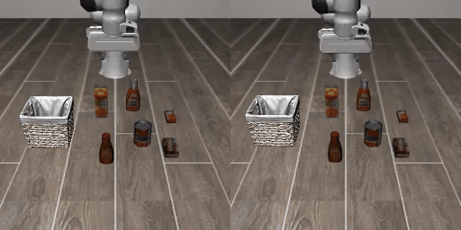
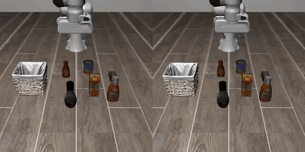

# Fine-tuned SmolVLA against ACT trained from scratch, with 5 to 50 demonstrations per task

At each data size, how does a fine-tuned pretrained vision-language-action model compare with a policy trained from scratch on the same demonstrations? To answer this, I trained two policies on three pick-and-place tasks from LIBERO-Object, a simulated benchmark with a Franka arm, using 5, 10, 20 or all (45 to 50) demonstrations per task. ACT was trained from scratch. SmolVLA was fine-tuned from a model pretrained on community data recorded with a different robot. I compare the two methods as they are normally used, each with its own model size and training recipe. In total, I tested 60 trained models, each one 50 times per task at each of its last 3 checkpoints: 9,000 simulated episodes.



Success rate pooled over the three tasks. The line is the mean over training seeds (3 for ACT, 2 for SmolVLA), each dot is one seed, and the shaded band is the range across seeds. One seed point pools 3 tasks, 3 checkpoints and 50 episodes, 450 episodes in all.

## Findings

**Data efficiency.** On three LIBERO-Object tasks in simulation, SmolVLA fine-tuned on 5 demonstrations per task (78% success) did better than ACT trained from scratch on all of them, about 47 per task (55% success). Every SmolVLA training seed with 5 demonstrations beat every ACT seed trained on all of them. The gap got smaller as more data was added, from 60 to 32 percentage points, but it never closed. On one task (BBQ sauce), the two methods were close when trained on all demonstrations. SmolVLA is also the larger model and cost more to train, so this is about data efficiency, not compute (see [Compute and cost](#compute-and-cost)).

**Stability.** ACT's results depended a lot on training randomness. The variance between its three evaluated checkpoints was about nine times what evaluation noise alone predicts, and the checkpoints differed significantly in 30 of 36 runs. The training seed added a further spread of about 14 percentage points. SmolVLA's checkpoints varied only as much as evaluation noise predicts: 2 of its 24 runs showed a significant difference, about what chance alone gives. Its seeds added about 3 points. In practice, the choice of which ACT checkpoint to deploy matters.

**Failure behaviour.** In 90 evaluation videos that I coded without knowing which method produced them, almost every failure of both methods started with a missed or dropped grasp. ACT usually tried again after a miss (in 24 of 31 cases) but recovered only once. Its typical failure was hovering over the object until the time limit. SmolVLA's failures were mostly a single miss with no second attempt. SmolVLA did recover twice, but two cases are too few to estimate a recovery rate.

**An open question.** SmolVLA's per-task curves dip in two places: on chocolate pudding from 95% with 5 demonstrations to 67% with 10, and on BBQ sauce from 86% with 10 to 58% with 20. The drops happened with both training seeds and with nested training sets. This suggests sensitivity to the added data or to how it interacts with training, but the cause is still unknown. The added demonstrations do not look unusual on any measure I checked (length, number of gripper closures, timing of the first grasp, path length, idle time, jerk). Finding the cause needs retraining on different subsets of demonstrations, which I leave for later work.

## Results

| Demonstrations per task | SmolVLA, per seed | SmolVLA, mean (Wilson 95%) | ACT, per seed | ACT, mean (Wilson 95%) | Gap (points) |
| --- | ---: | ---: | ---: | ---: | ---: |
| 5 | 76.0 / 80.0 | **78.0** (75.2 to 80.6) | 10.4 / 10.9 / 32.4 | **17.9** (16.0 to 20.1) | 60.1 |
| 10 | 81.3 / 83.6 | **82.4** (79.8 to 84.8) | 17.1 / 54.0 / 32.7 | **34.6** (32.1 to 37.2) | 47.9 |
| 20 | 72.0 / 76.4 | **74.2** (71.3 to 77.0) | 38.9 / 46.2 / 14.2 | **33.1** (30.7 to 35.7) | 41.1 |
| all (45 to 50) | 88.0 / 86.7 | **87.3** (85.0 to 89.3) | 57.8 / 53.1 / 55.3 | **55.4** (52.7 to 58.0) | 31.9 |

Success rates in percent, pooled over the three tasks. Seeds are listed in the order 1000, 2000, 3000. Each SmolVLA mean pools 900 episodes and each ACT mean 1,350. The Wilson interval covers evaluation sampling only. It treats those episodes as independent, but they share the same 50 starting scenes and come from 3 checkpoints of the same runs. The spread across seeds is a better guide to the real uncertainty.

SmolVLA is above 50% with 5 demonstrations, the smallest size tested, for both seeds. ACT's mean passes 50% only with all demonstrations. One ACT seed passed it at 10 demonstrations and fell below it again at 20.

### Final checkpoint only

The table above averages each run's last three checkpoints. A deployed robot would run a single checkpoint, so this table uses only the last one: ACT at 10,000 steps and SmolVLA at 5,000.

| Demonstrations per task | SmolVLA, per seed | SmolVLA, mean | ACT, per seed | ACT, mean |
| --- | ---: | ---: | ---: | ---: |
| 5 | 77.3 / 76.7 | **77.0** | 16.0 / 8.7 / 52.7 | **25.8** |
| 10 | 82.0 / 82.7 | **82.3** | 31.3 / 63.3 / 40.0 | **44.9** |
| 20 | 72.0 / 74.0 | **73.0** | 44.0 / 52.7 / 15.3 | **37.3** |
| all (45 to 50) | 84.7 / 86.0 | **85.3** | 62.7 / 37.3 / 59.3 | **53.1** |

Success rates in percent, pooled over the three tasks, 150 episodes per seed. The result is the same: SmolVLA's worst seed with 5 demonstrations (77%) is still above ACT's best seed with all of them (63%). ACT's seeds spread wider here, from 9% to 53% at 5 demonstrations, because a single checkpoint keeps all of ACT's checkpoint-to-checkpoint variation.

### Per task



| Task | Method | 5 | 10 | 20 | all |
| --- | --- | ---: | ---: | ---: | ---: |
| BBQ sauce (46 demos) | SmolVLA | 66.7 | 85.7 | 58.0 | 77.0 |
| BBQ sauce (46 demos) | ACT | 29.1 | 64.0 | 46.0 | 71.3 |
| Butter (45 demos) | SmolVLA | 72.7 | 95.0 | 95.3 | 88.0 |
| Butter (45 demos) | ACT | 9.8 | 17.8 | 21.1 | 44.2 |
| Chocolate pudding (50 demos) | SmolVLA | 94.7 | 66.7 | 69.3 | 97.0 |
| Chocolate pudding (50 demos) | ACT | 14.9 | 22.0 | 32.2 | 50.7 |

Mean over seeds, in percent, 150 episodes per seed. Per-seed values are in [results/analysis.md](results/analysis.md).

Butter is ACT's hardest task: 44% with all 45 demonstrations, against 95% for SmolVLA with 10. Task by task, SmolVLA's worst seed beats ACT's best all-demonstrations seed at every size on butter, at every size except 10 on chocolate pudding, and only at 10 on BBQ sauce. So SmolVLA's lead is clear over the three tasks together, but task by task it depends on the task.

### Stability



Each ACT run was scored at 6k, 8k and 10k training steps, and each SmolVLA run at 3k, 4k and 5k, with 50 episodes per checkpoint. If the three checkpoints of a run were equally good, sampling 50 episodes would still give them a standard deviation of 5 to 6 points. ACT's checkpoints had a standard deviation of 17.8 points. SmolVLA's had 5.3, the value that independent sampling would give. One ACT run scored 26, 5 and 6 out of 50 at its three checkpoints. Because all checkpoints play the same 50 scenes, I also compared them scene by scene with a paired test (Cochran's Q): ACT's checkpoints differed significantly in 30 of 36 runs and SmolVLA's in 2 of 24. Taking the mean of the last three checkpoints means that one lucky or unlucky checkpoint cannot decide a run's score (see [Pilot](#pilot)).

### How the policies fail



Butter, 10 demonstrations. Left: SmolVLA (seed 2000, checkpoint 4k) picks up the butter and places it. Right: ACT (seed 3000, checkpoint 6k) misses the grasp and keeps trying until the time limit.



Chocolate pudding, 5 demonstrations. Left: ACT (seed 2000, checkpoint 8k) reaches the pudding behind the bottle, misses and keeps trying until the time limit. Right: SmolVLA (seed 1000, checkpoint 4k) misses its first grasp, tries again and succeeds, one of its two recoveries in the sample. All clips were picked at random from the coded videos of each kind, and they play at a quarter of real speed.

| Coded videos (blind to method) | ACT | SmolVLA |
| --- | ---: | ---: |
| Videos coded (failures, successes) | 45 (30, 15) | 45 (22, 23) |
| Failures that began with a missed or dropped grasp | 29 of 30 | 19 of 22 |
| After a missed or dropped grasp: tried again | 24 of 31 | 7 of 21 |
| After a missed or dropped grasp: still succeeded | 1 of 31 | 2 of 21 |

I coded a random sample of 90 evaluation videos. For each method, it has 10 failures and 5 successes from each of three groups: 5 demonstrations, all demonstrations, and butter with 10 demonstrations. SmolVLA had only 2 failures on butter with 10 demonstrations, so that group has 2 failures and 13 successes. The videos were shuffled and shown without the method name in a small local page (`scripts/code_videos.py`). The table shows raw counts. Because failures are over-sampled, the rates weighted back to each group's real success rate are in [results/analysis.md](results/analysis.md), section 8. Only episodes 0 to 9 of each evaluation have video.

### Does more training help ACT on butter?

Every run gets the same number of training steps, so larger training sets get fewer passes over the data: about 12 with all demonstrations against about 110 with 5. The all-demonstrations ACT runs could therefore be under-trained. To check this, I trained three extra ACT runs on butter with all demonstrations for 30,000 steps instead of 10,000. Their last three checkpoints scored 39%, against 44% for the 10,000-step runs, so three times more training did not help on this task. These runs are not part of the main results ([results/diagnostics.csv](results/diagnostics.csv)).

### Starting scenes

Episode i starts from the same LIBERO scene in every run, so scenes can be compared across methods. Some scenes are harder than others for both methods. But only on butter do the two methods find the same scenes hard (Spearman correlation 0.48, against 0.13 on chocolate pudding and -0.08 on BBQ sauce). So the gap between the methods does not come from a few impossible scenes. Details and a figure are in [results/analysis.md](results/analysis.md), section 5.

## Conclusion

In this setup, the SmolVLA fine-tuning recipe I tested was much more data-efficient than the ACT recipe: SmolVLA with 5 demonstrations per task did better than ACT with all of them, about 47 per task. It was also more predictable. Its checkpoints and seeds gave almost the same results, so one training run was a good guide to the next. ACT's score depended as much on luck as on data. At 10 demonstrations, its three seeds went from 17% to 54%, a spread as large as its whole gain from 5 demonstrations to all of them (from 18% to 55%). SmolVLA's base model was pretrained on community data from a different, low-cost arm, not the Franka arm, and the fine-tuned policy still learned these tasks from a handful of demonstrations.

The next question is how much of this gap comes from SmolVLA's robot pretraining itself, since the two models also differ in size, architecture and language input. To answer it, I would fine-tune SmolVLA twice with everything else equal: once from its pretrained action expert and once from a freshly initialised one (the vision-language part stays pretrained in both). After that, I would test whether SmolVLA's dips come from specific demonstrations, by training on several different subsets of the same size.

## Setup

### Tasks and data

LIBERO-Object has ten tasks. In each one, a Franka arm picks up a grocery item and places it in a basket. I used three of them: BBQ sauce, butter and chocolate pudding (simulator task ids 3, 6 and 8). They have 46, 45 and 50 demonstrations in the [lerobot/libero](https://huggingface.co/datasets/lerobot/libero) dataset. I chose the tasks with a fixed rule before any training: I excluded tasks where the published SmolVLA LIBERO checkpoint scored below 7 out of 10 in my setup check, then drew 3 of the remaining 8 at random (seed 0).

For each task the training sets are nested: the 5 demonstrations are inside the 10, which are inside the 20 ([configs/splits.json](configs/splits.json), drawn once with seed 0). Both methods train on exactly the same episodes at each size.

### Methods

[ACT](https://arxiv.org/abs/2304.13705) is a 52M-parameter transformer that predicts chunks of 100 future actions. It is trained from scratch on the demonstrations, except for its ResNet-18 image encoder, which LeRobot initialises from ImageNet weights. [SmolVLA](https://arxiv.org/abs/2506.01844) is a 450M-parameter vision-language-action model that also reads the task instruction. I fine-tuned it from [lerobot/smolvla_base](https://huggingface.co/lerobot/smolvla_base) (revision `5e8d12a`). That model was pretrained on community datasets recorded with the low-cost SO-100 arm, a different robot from LIBERO's Franka arm. As in the SmolVLA paper's simulation experiments, only the action expert is trained (about 100M parameters), and the vision-language model stays frozen.

### Pilot

Before the main runs, I ran one pilot for each method on BBQ sauce with all 46 demonstrations. It had three goals: check that training and evaluation work end to end, measure the time and cost of one run, and fix the settings for the main runs. ACT trained on the laptop for 100,000 steps, then again for 30,000 steps with a checkpoint every 5,000. SmolVLA trained on Hugging Face Jobs for 20,000 steps, which cost $4.48.

The pilot fixed four things. First, ACT re-plans every 10 actions instead of running a full chunk blind (see [Evaluation](#evaluation)). Second, the step budgets. ACT gets 10,000 steps: its checkpoints at 5,000 and 10,000 steps both scored 19 out of 20. SmolVLA gets 5,000: its 5,000-step checkpoint scored 16 out of 20, against 16 to 18 for the later ones, and training it for 20,000 steps would have cost about $4 per run, too much for my budget of about 30 euros. Third, ACT's score moved a lot between nearby checkpoints: it fell from 19 to 9 out of 20 between 10,000 and 15,000 steps. In the first ACT pilot run, evaluated with the default chunk execution, the training loss kept falling while the success rate went down, so the loss could not show which checkpoint was good. That is why each run is scored in the simulator, as the mean of its last three checkpoints. Fourth, both methods scored well above zero with all demonstrations (ACT 43 out of 50, SmolVLA 41 out of 50), so the main experiment could go ahead.

### Training

| | ACT | SmolVLA |
| --- | --- | --- |
| Starting weights | random, ImageNet ResNet-18 image encoder | `lerobot/smolvla_base` |
| Trained parameters | 52M | 100M of 450M (action expert) |
| Training steps (every size) | 10,000 | 5,000 |
| Batch size | 8 | 32 |
| Evaluated checkpoints | 6k, 8k, 10k | 3k, 4k, 5k |
| Training seeds | 1000, 2000, 3000 | 1000, 2000 |
| Hardware | laptop, RTX 4050 6 GB | Hugging Face Jobs, L4 24 GB |

The step budgets come from the pilot and are the same for every demonstration count. They were not tuned on test results after that.

### Evaluation

Each checkpoint runs 50 episodes per task, starting from LIBERO's 50 fixed initial scenes, so every run sees the same scenes in the same order. A run's score is the mean over its last three checkpoints, 150 episodes per task. Both policies re-plan every 10 actions and see 256 by 256 pixel images, the resolution of the training data. All 180 checkpoint evaluations ran on the same laptop with the same CPU renderer.

By default, ACT executes all 100 actions of a chunk before looking at the scene again. In the pilot, this made it miss grasps and continue without trying again: one checkpoint scored 10 out of 20 episodes with the default and 16 out of 20 when re-planning every 10 actions. SmolVLA is evaluated the same way. Re-planning after every action gave it no gain, at seven times the evaluation time. I chose these settings on the test scenes of the BBQ sauce task and did not keep separate validation scenes.

The comparison follows a few fixed rules:

- Both methods train on the same demonstration episodes at every size.
- Both are evaluated on the same scenes with the same seed (1000), image size and renderer.
- Each method's training budget was fixed before the main runs.
- [HuggingFaceVLA/smolvla_libero](https://huggingface.co/HuggingFaceVLA/smolvla_libero), which was trained on all of LIBERO, was used only for the setup check, never as a starting point.
- The dataset revision and the LeRobot commit are pinned (see below).

## How to reproduce

Tested on Windows with WSL2 (Ubuntu), Python 3.12, PyTorch 2.11.0 with CUDA 13.0, LeRobot 0.6.2 at commit [`b9cb121`](https://github.com/huggingface/lerobot/tree/b9cb121cb7d4e3e26ec5c906d08dda68d151ba52), dataset `lerobot/libero` at revision `a1aaacb7f6cd6ee5fb43120f673cebb0cfea7dd4`, base model `lerobot/smolvla_base` at revision `5e8d12a6e2975b0e5e5fce7c8caf47c371d257b6`, and `huggingface_hub` 1.33.0.

```bash
# environment
conda create -n lerobot python=3.12 -y && conda activate lerobot
git clone https://github.com/huggingface/lerobot ~/lerobot && cd ~/lerobot
git checkout b9cb121cb7d4e3e26ec5c906d08dda68d151ba52
pip install -e ".[training,smolvla,libero]"
pip install "huggingface_hub==1.33.0"      # do not run `hf update`: version 2.x breaks this LeRobot version
export MUJOCO_GL=egl                       # in every new terminal

# experiment (from this repository's root); every setting comes from configs/runs.yaml
python scripts/train_grid.py --method act --seed-index 1          # ACT on the local GPU; also 2 and 3
python scripts/train_grid.py --method smolvla --seed-index 1      # SmolVLA on Hugging Face Jobs; also 2
python scripts/eval_grid.py --method act --seed-index 1           # 50 episodes x 3 checkpoints per run
python scripts/eval_grid.py --method smolvla --seed-index 1 --download   # downloads the checkpoints first
python scripts/analyze.py                                          # figures, results/analysis.md, results/summary.json
```

Add `--dry-run` to the training and evaluation scripts to print the exact `lerobot-train` and `lerobot-eval` commands without running them. All 60 trained models are in a [Hugging Face collection](https://huggingface.co/collections/Pipe1213/smolvla-and-act-on-libero-object-5-to-50-demos-6adfec8eea235665e9d43137), each with a model card listing its results. To evaluate one of them:

```bash
lerobot-eval --policy.path=Pipe1213/act_obj_t2_nall \
  --env.type=libero --env.task=libero_object --env.task_ids="[6]" \
  --env.init_states=true --env.observation_height=256 --env.observation_width=256 \
  --eval.n_episodes=50 --eval.batch_size=1 --seed=1000 --policy.n_action_steps=10
# SmolVLA checkpoints also need:
#   --rename_map='{"observation.images.image": "observation.images.camera1", "observation.images.image2": "observation.images.camera2"}'
```

The repository root of each model holds its last checkpoint, and `checkpoints/<step>/pretrained_model` holds all three evaluated ones.

## Compute and cost

| Work | Where | Time | Cost |
| --- | --- | ---: | ---: |
| ACT, 36 runs | laptop, RTX 4050 6 GB | 14.8 h training | 0 |
| SmolVLA, 24 runs | Hugging Face Jobs, L4 24 GB | 34.2 h billed | $27.36 |
| Evaluation, 180 checkpoints, 9,000 episodes | laptop, CPU rendering | 54.7 h | 0 |
| Pilots (ACT and SmolVLA) | laptop and Hugging Face Jobs | 11.9 h training | $4.48 |
| Butter diagnostic, 3 ACT runs | laptop | 3.3 h training, 4.6 h evaluation | 0 |

The whole project cost $31.84 in cloud compute. Evaluation was the slowest part: in WSL2 the GPU works for CUDA but not for rendering, so the simulator drew every frame on the CPU.

## Limitations and disclosures

- **Scope.** Three tasks from one simulated benchmark, one robot, no real hardware. These results don't cover other kinds of tasks or real robots yet.
- **Two different models, not an ablation.** SmolVLA and ACT differ in pretraining, but also in size, architecture and language input. The gap between them mixes all of these. Fine-tuning SmolVLA with a freshly initialised action expert would isolate the effect of its robot pretraining.
- **Compute is not matched.** SmolVLA is a larger model and took more GPU time per run. The question here is how each method does with few demonstrations, not which one is cheaper to train.
- **ACT was not tuned.** It used LeRobot's default settings, plus re-planning every 10 actions. A tuned ACT might do better with the same data.
- **"From scratch" means no robot pretraining.** ACT's image encoder starts from ImageNet weights, as in LeRobot's default.
- **Seeds were added after seeing results.** The second training seed (both methods) was added after I saw the first seed's results, and it was applied to every run. The third seed is ACT only. I decided it before seeing any of its results, because ACT's seeds differed by up to 45 points and SmolVLA's by up to 11, and the cloud budget was spent.
- **Task selection.** The three tasks were chosen among LIBERO-Object tasks that the published SmolVLA LIBERO checkpoint already solved (7 or more out of 10 in my setup check). The results describe these tasks.
- **Settings chosen on test scenes.** The pilot settings (re-planning, step budgets, checkpoint averaging) were chosen on BBQ sauce test scenes.
- **Normalisation statistics.** LeRobot normalises states and actions with statistics computed over the whole `lerobot/libero` dataset, not only the selected demonstrations (checked: the 5-demonstration and 46-demonstration runs have identical statistics). This is the same for both methods.
- **Setup check.** The published `HuggingFaceVLA/smolvla_libero` scored 88% on LIBERO-Object in this evaluation setup (100 episodes, 95% interval 80 to 93%). The SmolVLA paper reports 96%.
- **Failure coding** was done by one person (me), blind to method, on episodes 0 to 9 only.

## Repository layout

```
configs/    runs.yaml (frozen grid and settings), splits.json (episode ids per task and size)
scripts/    make_splits, train_grid, eval_grid, eval_sweep, analyze, make_coding_sample,
            code_videos, make_gifs, inspect_demos, hub_cleanup, hub_publish, make_model_cards, check_numbers
results/    results.csv (one row per run and checkpoint, with per-episode outcomes), diagnostics.csv,
            compute_log.csv, pilot_sweep.csv, analysis.md, summary.json, figures/
notes/      failure_log.md, coding_sample.csv, failure_codes.csv, demo_stats.csv, demo_inspection.md
```

## Links

- Trained models: [Hugging Face collection](https://huggingface.co/collections/Pipe1213/smolvla-and-act-on-libero-object-5-to-50-demos-6adfec8eea235665e9d43137) (60 models, 3 evaluated checkpoints each, with model cards)

## References

- T. Z. Zhao, V. Kumar, S. Levine, C. Finn. Learning Fine-Grained Bimanual Manipulation with Low-Cost Hardware (ACT). RSS 2023. [arXiv:2304.13705](https://arxiv.org/abs/2304.13705)
- M. Shukor et al. SmolVLA: A Vision-Language-Action Model for Affordable and Efficient Robotics. 2025. [arXiv:2506.01844](https://arxiv.org/abs/2506.01844)
- B. Liu et al. LIBERO: Benchmarking Knowledge Transfer for Lifelong Robot Learning. NeurIPS 2023 Datasets and Benchmarks. [arXiv:2306.03310](https://arxiv.org/abs/2306.03310)
- A. Mandlekar et al. What Matters in Learning from Offline Human Demonstrations for Robot Manipulation. CoRL 2021. [arXiv:2108.03298](https://arxiv.org/abs/2108.03298)
- F. Lin et al. Data Scaling Laws in Imitation Learning for Robotic Manipulation. 2024. [arXiv:2410.18647](https://arxiv.org/abs/2410.18647)
- [LeRobot](https://github.com/huggingface/lerobot), Hugging Face.

Code written with AI assistance (Claude); experiment design, runs and analysis by me.

Licence: MIT.
